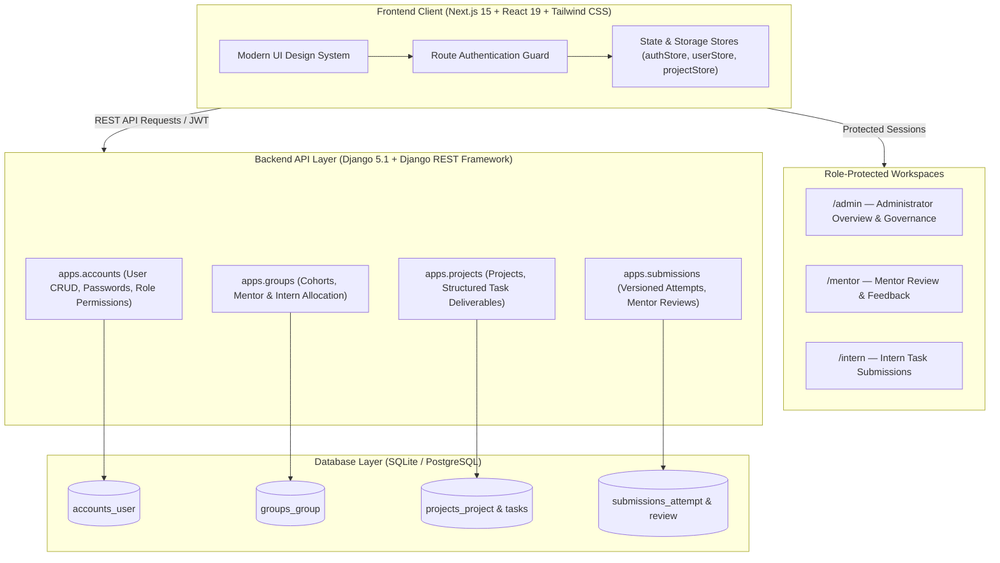
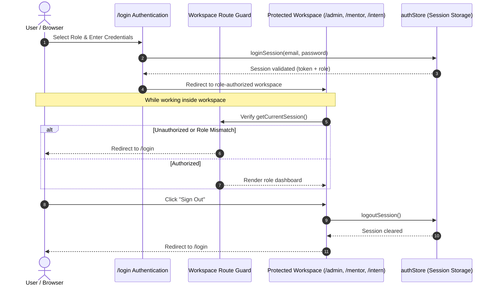
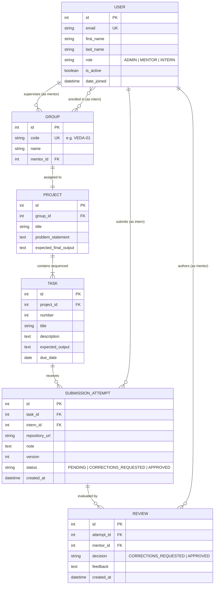

# VEDA — Internship Task Submission & Mentor Review Portal

A full-stack engineering internship portal designed for curriculum milestone tracking, versioned task submissions, mentor reviews, and administrative cohort governance.

---

## 🏛️ System Architecture

VEDA is built as a decoupled full-stack platform featuring a Next.js 15 App Router frontend and a Django REST Framework (DRF) backend with role-based access control.



---

## 🔐 Authentication & Session Security Architecture

VEDA implements strict role-based route protection to ensure interns, mentors, and administrators only access their authorized workspaces.



### Role Capabilities & Access Matrix

| Feature / Capability | Intern (`INTERN`) | Mentor (`MENTOR`) | Administrator (`ADMIN`) |
| :--- | :---: | :---: | :---: |
| **Authenticate via `/login`** | ✅ | ✅ | ✅ |
| **View Milestone Tasks & Acceptance Criteria** | ✅ | ✅ | ✅ |
| **Submit Task Deliverable (Versioned Attempt)** | ✅ | ❌ | ❌ |
| **Review Submissions & Approve / Request Corrections** | ❌ | ✅ | ✅ |
| **Provide Written Feedback on Submissions** | ❌ | ✅ | ✅ |
| **Add / Delete Portal Users** | ❌ | ❌ | ✅ |
| **Change User Email Address & Reset Passwords** | ❌ | ❌ | ✅ |
| **Create, Edit & Delete Curriculum Projects** | ❌ | ❌ | ✅ |
| **Assign Projects to Cohort Groups & Supervising Mentors** | ❌ | ❌ | ✅ |
| **Add Milestone Tasks & Set Due Dates** | ❌ | ❌ | ✅ |
| **Programme KPIs & Submissions Analytics** | ❌ | ❌ | ✅ |

---

## 🗄️ Database & Domain Model Architecture



---

## 📁 Repository Directory Structure

```text
veda-project/
├── backend/                        # Django REST Framework Backend
│   ├── apps/
│   │   ├── accounts/               # Custom User, authentication, and user CRUD endpoints
│   │   │   ├── models.py           # AbstractUser with email USERNAME_FIELD and Role choices
│   │   │   ├── serializers.py      # UserSerializer, CreateSerializer, ChangeEmail/Password
│   │   │   ├── views.py            # AdminUserViewSet, change-email and change-password actions
│   │   │   └── urls.py             # Router routes for /api/accounts/users/
│   │   ├── groups/                 # Cohort management and mentor assignments
│   │   │   ├── models.py           # Group model with mentor FK and interns M2M
│   │   │   ├── serializers.py      # GroupSerializer with nested mentor and interns
│   │   │   ├── views.py            # GroupViewSet with assign-mentor action
│   │   │   └── urls.py             # Router routes for /api/groups/
│   │   ├── projects/               # Curriculum projects & structured task deliverables
│   │   │   ├── models.py           # Project & Task models
│   │   │   ├── serializers.py      # ProjectSerializer, TaskSerializer
│   │   │   ├── views.py            # ProjectViewSet (CRUD + assign-group) & TaskViewSet
│   │   │   ├── management/         # Management commands
│   │   │   │   └── commands/
│   │   │   │       └── seed_demo.py # Database seeder script
│   │   │   └── urls.py             # Router routes for /api/projects/ and /api/projects/tasks/
│   │   └── submissions/            # Submission attempts and mentor reviews
│   │       └── models.py           # SubmissionAttempt and Review models
│   ├── config/                     # Django project configuration
│   │   ├── settings.py             # DRF, Simple JWT, CORS, database settings
│   │   └── urls.py                 # Root URL configuration (/api/accounts/, /api/groups/, etc.)
│   ├── manage.py
│   └── requirements.txt
│
└── frontend/                       # Next.js 15 App Router Frontend
    ├── src/
    │   ├── app/
    │   │   ├── admin/              # Administrator Dashboard (/admin)
    │   │   ├── mentor/             # Mentor Review Portal (/mentor)
    │   │   ├── intern/             # Intern Workspace (/intern)
    │   │   ├── login/              # Portal Authentication (/login)
    │   │   ├── layout.tsx          # Root Layout & Typography
    │   │   └── page.tsx            # Landing Page with secure entry points
    │   ├── components/
    │   │   ├── admin/              # Administrative Dialogs & Modals
    │   │   │   ├── AddUserModal.tsx           # Provision user (name, email, role, password)
    │   │   │   ├── EditUserModal.tsx          # Edit profile & change email address
    │   │   │   ├── ChangeUserPasswordModal.tsx# Reset user password with auto-generator
    │   │   │   ├── DeleteUserModal.tsx        # Delete confirmation with admin protection
    │   │   │   ├── AddProjectModal.tsx        # Add project with group & mentor assignment
    │   │   │   ├── EditProjectModal.tsx       # Update project specifications
    │   │   │   ├── AssignProjectModal.tsx     # Assign project to cohort & mentor
    │   │   │   ├── DeleteProjectModal.tsx     # Delete curriculum project
    │   │   │   ├── AddTaskModal.tsx           # Add milestone deliverable task
    │   │   │   └── ReassignMentorModal.tsx    # Reassign supervising mentor
    │   │   ├── views/              # Tab Views for Admin Dashboard
    │   │   │   ├── OverviewView.tsx           # Live KPIs & submission activity
    │   │   │   ├── UsersView.tsx              # User table with add/edit/password/delete actions
    │   │   │   ├── GroupsView.tsx             # Cohort clusters & mentor assignment cards
    │   │   │   ├── ProjectsView.tsx           # Curriculum milestones & task deliverables
    │   │   │   ├── SubmissionsView.tsx        # Global submission review auditing
    │   │   │   └── SettingsView.tsx           # Workspace configurations
    │   │   ├── Header.tsx          # Top navigation bar & notifications
    │   │   ├── Sidebar.tsx         # Sidebar navigation
    │   │   ├── UserAvatar.tsx      # Role-colored avatar with initials
    │   │   └── RoleBadge.tsx       # Formatted role indicator badges
    │   └── lib/
    │       ├── authStore.ts        # Client session management & route authentication
    │       ├── userStore.ts        # User CRUD & password store with localStorage persistence
    │       ├── projectStore.ts     # Project, task & group assignment store
    │       ├── types.ts            # TypeScript interfaces & types
    │       └── mockData.ts         # Seed data structures
    ├── package.json
    └── tsconfig.json
```

---

## 🚀 Quickstart & Local Setup

### 1. Prerequisites
- **Node.js** (v18.17+ or LTS) & **npm**
- **Python** (3.11+)

---

### 2. Backend Setup

From `backend/`:

```powershell
# Create & activate virtual environment (Windows PowerShell)
py -m venv .venv
.\.venv\Scripts\Activate.ps1

# Install dependencies
pip install -r requirements.txt

# Configure environment file
Copy-Item .env.example .env

# Apply database migrations
python manage.py makemigrations accounts groups projects submissions
python manage.py migrate

# Seed synthetic demo dataset
python manage.py seed_demo

# Launch development server
python manage.py runserver
```

> **API Base URL**: `http://127.0.0.1:8000/api/`  
> **Health Check**: `http://127.0.0.1:8000/healthz/`

---

### 3. Frontend Setup

From `frontend/`:

```bash
# Install dependencies
npm install

# Configure environment
cp .env.example .env.local

# Run Next.js development server
npm run dev
```

> **Frontend Application**: `http://localhost:3000`

---

## 🔑 Demo Seed Accounts

| Role | Account Name | Email | Default Password | Workspace Destination |
| :--- | :--- | :--- | :--- | :--- |
| **Administrator** | Super Admin | `admin@veda.internal` | `Admin@2026` | `/admin` |
| **Mentor** | Dr. Anish Sharma | `anish.sharma@veda.internal` | `Mentor@2026` | `/mentor` |
| **Mentor** | Ananya Das | `ananya.das@veda.internal` | `Mentor@2026` | `/mentor` |
| **Intern** | Aarav Mehta | `aarav.mehta@veda.internal` | `Intern@2026` | `/intern` |
| **Intern** | Priya Nair | `priya.nair@veda.internal` | `Intern@2026` | `/intern` |
| **Intern** | Kabir Singh | `kabir.singh@veda.internal` | `Intern@2026` | `/intern` |
| **Intern** | Aditi Sharma | `aditi.sharma@veda.internal` | `Intern@2026` | `/intern` |

---

## 🛡️ Core System Rules & Guarantees

1. **Role Enforcement**:
   - Unauthorized access attempts to `/admin`, `/mentor`, or `/intern` are blocked and redirected to `/login`.
   - Direct role-switching without authentication is disallowed. Users must sign out to switch accounts.
2. **Immutable Submission History**:
   - Resubmissions create a new version attempt (e.g., `Attempt v2`, `Attempt v3`). Previous attempts and review logs are never overwritten.
3. **Mandatory Written Review Feedback**:
   - Mentors cannot request corrections without providing detailed written guidance.
4. **Root Administrator Safeguard**:
   - The primary root administrator (`admin@veda.internal`, ID 1) cannot be deleted by any administrator action.
5. **Data Privacy**:
   - Only synthetic users, cohort codes, and demonstration repositories are used for development.
